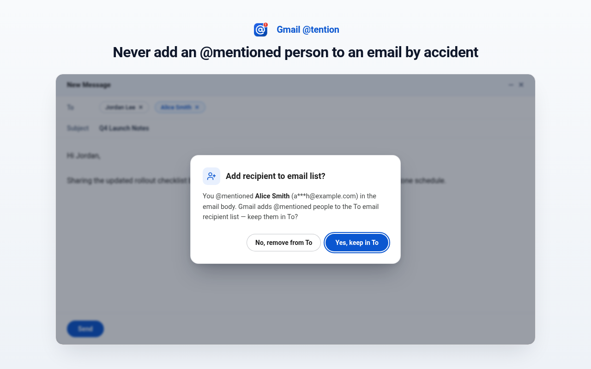
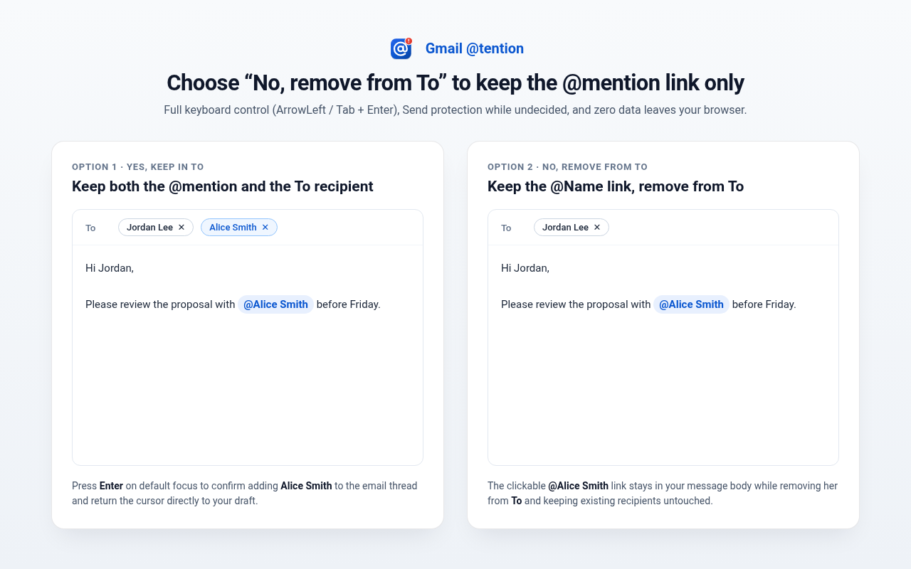

<div align="center">
  
  <h1>Gmail @tention</h1>
  <p><strong>Never add an @mentioned person to an email recipient list by accident.</strong></p>
  <p>
    <a href="https://github.com/etiennenoel/gmail-attention/actions/workflows/ci.yml"></a>
    <a href="LICENSE"></a>
  </p>
</div>

---

In Gmail, typing `@` in a compose draft and selecting a contact from the autocomplete menu silently adds that person to the email's **`To`** recipient list.

**Gmail @tention** is a zero-permission, 100%-local Manifest V3 Chrome extension written in strict TypeScript. Whenever an `@`-mention selection adds a contact in a Gmail compose body (`https://mail.google.com/*`), it immediately steals focus with a clean top-layer modal and pauses `Send` (`Send` click and `Cmd+Enter` / `Ctrl+Enter`) until you choose:

- **Yes, keep in To** *(default focus — press `Enter`)* — keeps both the `@Name` link in your email body and the person in Gmail's `To` recipient list.
- **No, remove from To** *(`ArrowLeft` / `Tab` + `Enter`, or click)* — keeps the clickable `@Name` `mailto:` link in your email body (detached from Gmail's recipient-sync tracker so later edits do not re-add them) and removes the newly added recipient chip from `To`, while leaving pre-existing thread recipients untouched.

## Preview

<p align="center">
  
  
</p>

## Privacy & Security Guarantees

- **Zero Extra Permissions:** Requests `"permissions": []` in [`src/manifest.json`](src/manifest.json).
- **100% Local Execution:** Makes zero network requests, collects zero telemetry, and runs exclusively on `https://mail.google.com/*`. See [`PRIVACY.md`](PRIVACY.md).
- **Hardened Closed Shadow DOM UI:** Built exclusively with safe DOM APIs (`createElement`, `createElementNS`, `textContent`, `replaceChildren` — zero `innerHTML`) inside a closed Shadow Root and top-layer `<dialog>`, with masked email display (`a***h@example.com`).

## Architecture

- [`src/manifest.json`](src/manifest.json) — Manifest V3 configuration, toolbar `action` (`popup.html`), strict extension CSP, icon map (`16`, `32`, `48`, `128`), `host_permissions` (`https://mail.google.com/*`), and content script declaration for `https://mail.google.com/*`.
- [`src/popup.html`](src/popup.html) & [`src/popup.entry.ts`](src/popup.entry.ts) — Toolbar diagnostic popup that pings the active Gmail tab (`GMAIL_ATTENTION_PING`), shows live compose-editor status, provides a 1-click **Reload Gmail Tab** button for tabs opened prior to installation, and surfaces site-access or corporate Chrome policy blocks so nothing fails silently.
- [`src/utils/gmail-dom.helper.ts`](src/utils/gmail-dom.helper.ts) — Targets Gmail compose message bodies (`div[g_editable="true"]`, `div[aria-label="Message Body"]`, `body[g_editable="true"]`), excludes auxiliary prompts (`To`/`Cc`/`Subject`, `"Describe your message"`) and quoted reply history (`.gmail_quote`, `blockquote`), distinguishes open `@...` queries from closed mention chips (`a.gmail_plusreply`), detaches declined `@Name` links from recipient sync, and removes newly added `To` recipient chips.
- [`src/utils/pii-masking.helper.ts`](src/utils/pii-masking.helper.ts) — Validates contact email shapes and masks addresses (`a***h@example.com`) before rendering UI text.
- [`src/ui/mention-confirmation.modal.ts`](src/ui/mention-confirmation.modal.ts) — Closed Shadow DOM + native `<dialog>` Yes/No modal supporting pointer clicks, full keyboard navigation (`Tab`, `Shift+Tab`, `ArrowLeft`, `ArrowRight`, `Enter`, `Space`), `Enter` bounce protection, `Escape` prevention, capture-phase focus recapture, and caret restoration to the compose body.
- [`src/core/gmail-mention.monitor.ts`](src/core/gmail-mention.monitor.ts) — State machine tracking active `@` sessions, pre-mention `To` recipient snapshots, open-to-closed chip transitions (preventing false positives on saved drafts, `+` mentions, and quoted replies), and pre-send blocking.
- [`scripts/`](scripts/) — Zero-runtime-dependency TypeScript build bundler ([`build-extension.script.ts`](scripts/build-extension.script.ts)), deterministic PKZIP Chrome Web Store packager ([`package-extension.script.ts`](scripts/package-extension.script.ts)), Chrome Web Store API v2 publisher ([`publish-cws.script.ts`](scripts/publish-cws.script.ts)), and SVG/HTML-to-PNG store asset generator ([`generate-assets.script.ts`](scripts/generate-assets.script.ts)).

## Local Development & Unpacked Installation

```bash
# Install dev dependencies
npm install

# Type-check, bundle dist/content.js, copy verified PNG icons, and emit dist/manifest.json
npm run build

# Run the Jest unit, edge-case, packager, and CWS publisher test suite
npm test

# Build a clean Chrome Web Store submission ZIP in release/gmail-attention.zip
npm run package
```

To load the unpacked extension locally in Chrome:

1. Run `npm run build` *(if testing on an enterprise-managed Chrome profile that requires a local allowlisted public key in `dist/manifest.json`, pass `-- --dev-key-file /path/to/public.key` — never committed to Git)*.
2. Navigate to `chrome://extensions` and enable **Developer mode**.
3. Click **Load unpacked** and select the generated `dist/` folder.
4. Reload `https://mail.google.com`.

## Chrome Web Store Artifacts & GitHub Actions CI/CD

- **Store Assets & Copy:** All Chrome Web Store graphics (`128×128` store icon, two `1280×800` screenshots, `440×280` small promo tile, and `1400×560` marquee promo tile) plus ready-to-paste Store Listing and Privacy Practices answers live in [`store-assets/`](store-assets/) and [`store-assets/CHROME_WEB_STORE_LISTING.md`](store-assets/CHROME_WEB_STORE_LISTING.md).
- **Continuous Integration ([`.github/workflows/ci.yml`](.github/workflows/ci.yml)):** Runs on every push and pull request to `main` — executes strict TypeScript type-checking, builds `dist/`, runs all Jest tests, validates and builds `release/gmail-attention.zip`, and uploads the store-ready ZIP as a workflow artifact.
- **Automated Releases & Chrome Web Store Publishing ([`.github/workflows/release.yml`](.github/workflows/release.yml)):** Pushing a version tag (`v*.*.*`, matching `"version"` in `src/manifest.json` and `package.json`) creates a GitHub Release with `release/gmail-attention-vX.Y.Z.zip` attached and publishes the package directly to the Chrome Web Store via **Chrome Web Store API v2**.

## License

[MIT](LICENSE) © Etienne Noël
